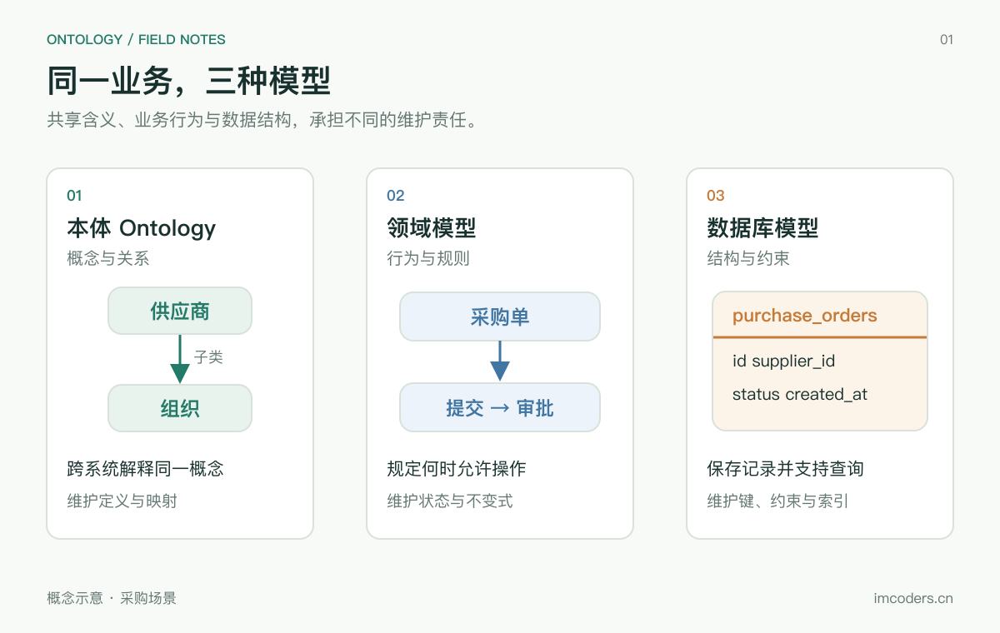
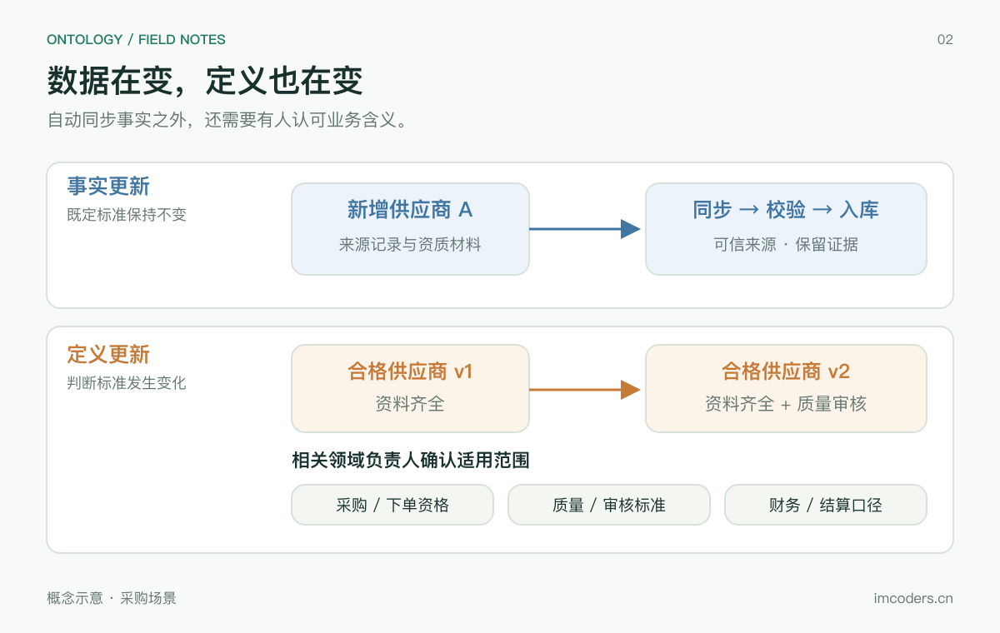
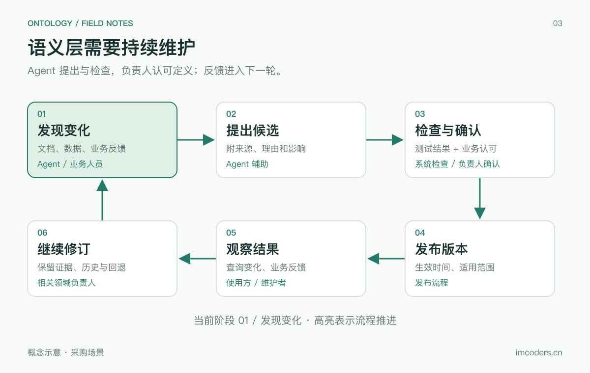

# 软件系统到底需不需要本体 Ontology

作者：杨正武
来源：https://imcoders.cn/blog/2026-11-06-ontology-necessity-feasibility/
发布：2026-11-06T00:00:00.000Z
更新：2026-11-07T00:00:00.000Z

从领域模型和数据库模型的边界出发，分析本体 Ontology 在跨系统语义、知识推理和 Agent 应用中的必要性，并讨论实现成本、语义层持续迭代的责任归属，以及 AI Agent 自动维护的边界。

---


软件里已经有数据库 Schema，也有领域模型。再引入一套 Ontology，要多维护什么，又能省下什么？如果这个问题说不清，RDF、OWL 和推理机很容易变成一份新的技术采购清单。

我的判断是，本体最值得投入的地方，是多个系统反复交换知识、却始终无法稳定对齐含义的场景。单个应用的业务规则，大多可以继续留在领域模型和数据库里。而一旦语义层被多个系统共同使用，谁持续维护它、谁有权修改定义，就会成为可行性判断里更难回避的问题。

## 三种模型各自承担什么责任

本文讨论知识工程中的本体，指对某个领域的概念、关系和公理作出明确描述。哲学中的本体论讨论范围更广；软件采用本体，也不意味着已经解决了关于现实世界的全部认识问题。

以采购业务为例，同一家企业可能在 CRM 中叫“客户”，在采购系统中叫“供应商”，在财务系统中叫“往来单位”。名称不同可能对应同一个主体，同名字段也可能有不同口径。

| 模型 | 采购场景里的问题 | 主要维护内容 |
| --- | --- | --- |
| 本体 | 供应商与法人主体是什么关系？不同系统中的记录是否指向同一组织？ | 概念定义、关系、公理、标识与映射 |
| 领域模型 | 采购单什么时候允许审批、取消和收货？ | 业务行为、状态变化、不变式与上下文边界 |
| 数据库模型 | 采购单怎样保存、关联、保证约束并支持查询？ | 数据结构、键、约束，以及物理层的索引等设计 |



这些职责存在重叠。数据库可以表达业务约束，领域模型也定义概念，本体也会包含限制条件。区分它们，应看模型服务的目标，以及由谁负责维护。

DDD 的领域模型也不必采用面向对象实现，更没有一条通用规定要求它采用封闭世界假设。系统把“未找到”解释成“不存在”，往往取决于业务边界和数据完整性承诺。数据库里的 NULL、尚未同步的数据，也提醒我们不能把“查不到”直接当成现实中的否定事实。

数据库建模同样包含概念层和逻辑层，不能全部归结为物理存储优化。将三者简单排成“本体负责理解、代码负责执行、数据库负责存储”，会低估已有软件工程的表达能力。

## 什么问题值得多维护一层本体

假设采购、质量和财务系统要共同回答：某个零件有哪些供应商，其中哪些主体属于同一个集团？只做一次报表，几张映射表和 SQL 就可能足够。如果几十个应用都要回答类似问题，各自维护一套“供应商”“集团成员”“供货关系”的解释，维护成本就会逐渐暴露。

本体在这里提供一套可复用的语义约定。应用可以共享概念标识和关系定义，再通过映射连接各自的数据。增加一个来源时，可以复用已经明确的含义，减少重复解释。

不过，创建一个 `Supplier` 类并不会自动完成实体对齐。两个供应商编号是否属于同一法人，仍需可靠的业务标识、匹配流程和人工处理。不同部门对“有效供应商”的定义也可能都合理，适合保留各自上下文。强行合并成一个全企业概念，会把真实差异藏起来。

我会用三个条件判断是否值得试点：

- 同一批概念和关系，已经被多个团队反复解释、映射和修正。
- 跨系统查询确实依赖这些含义，且有持续使用需求。
- 有业务负责人愿意维护定义，并处理口径冲突和版本变化。

缺少第三个条件，技术团队通常只能得到一份逐渐过期的词汇表。若需求集中在单应用 CRUD、事务一致性和少量固定报表，领域模型、数据库约束、数据字典往往已经够用。

有语义治理需求，也不代表马上需要完整 OWL。共享术语、稳定 ID 和映射规则可以先解决一部分问题。只有当概念分类和逻辑关系需要被机器反复使用时，形式化公理和推理才开始产生额外收益。

## RDF、OWL 和推理机实际做了什么

RDF 用主语、谓语、宾语三元组表示事实，IRI 为资源提供标识。它是一种数据模型，Turtle、JSON-LD 等则是表达 RDF 的序列化方式。采用图结构本身，并不保证不同来源的数据具有相同含义。[RDF 1.1 Concepts](https://www.w3.org/TR/rdf11-concepts/) 给出了这些结构的正式定义。

下面的例子用 Turtle 描述一个类层级和一个实例：

```turtle
@prefix ex: <https://example.org/procurement/> .
@prefix rdf: <http://www.w3.org/1999/02/22-rdf-syntax-ns#> .
@prefix rdfs: <http://www.w3.org/2000/01/rdf-schema#> .

ex:Organization a rdfs:Class .
ex:Supplier a rdfs:Class ;
    rdfs:subClassOf ex:Organization .
ex:SupplierA a ex:Supplier .
```

在支持相应 RDFS 推理的环境里，可以推出 `SupplierA` 也是 `Organization`。注意 `rdfs:subClassOf` 的大小写有意义；拼成另一个 IRI，就失去了这条标准语义。

OWL 可以继续描述类的交集、互斥关系、属性限制等。以 OWL 2 DL 为例，这些表达有描述逻辑基础，推理器可以检查一致性、计算类层级和判断逻辑蕴涵。但本体工程并不限于 OWL，OWL 的不同语义体系也不能全部混为一谈。[OWL 2 Primer](https://www.w3.org/TR/owl2-primer/) 介绍了这些区别。

### 开放世界会改变校验结果

假设定义“供应商至少有一个注册地址”。在 OWL 的开放世界语义下，某个供应商没有记录地址，仍可能只是地址未知，不能据此直接判定矛盾。它也不会自动生成一个真实可用的地址。

如果采购录入要求“缺少地址就拒绝保存”，应明确实现数据校验。RDF 体系中可以用 SHACL 描述数量、类型等要求；关系型系统则可以结合数据库约束和应用校验。OWL 的逻辑一致性与输入数据是否满足交付要求，是两种检查。[SHACL 规范](https://www.w3.org/TR/shacl/) 专门定义了针对 RDF 图的约束验证。

亲属推理也容易被讲错。“父亲的父亲是祖父”适合用属性链表达。把“父亲”声明为传递属性，会推出祖父也是父亲，改变关系的含义。推理器只能沿着建模者给定的定义计算，无法替人修正错误的业务概念。

### 查询与推理需要明确连接

SPARQL 匹配 RDF 图中的模式。查询所有组织，可以写成：

```sparql
PREFIX ex: <https://example.org/procurement/>
SELECT ?organization WHERE {
  ?organization a ex:Organization .
}
```

仅加载上述原始三元组、且未启用推理时，这个查询不会因为类层级的存在就自动返回 `SupplierA`。查询能否看见推导结果，取决于服务的推理配置，或是否已经将结果物化。

HermiT、Pellet 这样的描述逻辑推理器，不能直接理解为通用三元组库里的一层缓存。其一致性和分类任务涉及专门的推理算法；也不能假定它们会把所有隐含事实自动写回数据库。规则物化、查询改写、按需推导以及描述逻辑判定，需要根据所选引擎分别设计。

例如，Jena 提供推理接口以及前向、后向和混合规则引擎，同时明确说明内置 OWL 推理的覆盖范围与限制。接入一个写着“支持 OWL”的产品，仍要确认它支持哪些构造和哪些推理任务。[Jena 推理文档](https://jena.apache.org/documentation/inference/) 对这些边界有具体说明。

## 工程上能做多大，取决于选择了哪些能力

本体文件可以手写，也可以通过程序生成或使用编辑器维护。真正耗时的工作通常在文件之外：概念如何划界、历史数据如何映射、来源冲突如何裁决，以及一次修改会影响哪些消费者。

存储也有多种选择。可以把数据导入 RDF Store，也可以保留关系型数据，通过映射提供语义访问。不能预先断言关系库处理关联一定很慢，或图存储天然更快；查询形态、索引、数据规模和更新方式都会影响结果。

完整表达能力与大规模计算之间需要取舍。OWL 2 提供不同 Profile：EL 面向具有大量类和属性的本体，QL 便于面向关系数据库进行查询改写，RL 便于通过规则实现推理。这些子集通过限制表达能力改善特定任务的可计算性，并不承诺任何数据集都能低延迟运行。[OWL 2 Profiles](https://www.w3.org/TR/owl2-profiles/) 说明了它们的设计目标。

落地时可以评估三种安排：

| 安排 | 收益 | 需要承担的成本 |
| --- | --- | --- |
| 导入后物化选定的推导结果 | 查询时可直接读取结果 | 存储膨胀，更新与删除时维护推导依赖 |
| 查询时改写或按需推导 | 减少提前存储的结果 | 查询延迟和执行计划更难预测 |
| 离线检查定义，线上使用有限规则 | 在线行为较容易控制 | 明确接受推理覆盖范围的限制 |

“预先算出所有知识”在工程上过于宽泛。更可行的目标，是限定规则和任务，计算业务真正需要的闭包或查询答案。特别是删除事实时，一条结论可能还有其他依据，不能简单随源记录一起删除。

大规模验证也不能只报一个三元组数量。至少需要观察推导前后的数据量、导入耗时、更新后的可见延迟、查询 P95、内存峰值和失败恢复时间。本文没有进行生产压测，无法据此给出某个规模下的吞吐承诺。

## 语义层上线以后，谁继续维护它

采购系统新增一家供应商，通常只需要按照已有结构写入记录。但“合格供应商”的定义发生变化，影响会沿着共享语义传播出去。原来资料齐全就能入选，后来增加质量审核，再后来要求某项资质在有效期内，同一批供应商可能因此得到不同的分类结果。

这类变化必须区分事实更新和定义更新。前者在既定含义下增加或修正记录，后者改变判断记录的标准。自动同步数据可以让知识库保持新鲜，却无法独自决定什么样的供应商应该获得采购资格。

| 变化 | 可以交给系统的工作 | 需要明确承担的责任 |
| --- | --- | --- |
| 收到新的供应商或资质记录 | 同步、去重、格式校验、记录来源 | 确认来源可信，处理异常 |
| 发现两个系统使用不同名称 | 提出同义词或映射候选 | 判断是否同义，保留必要的口径差异 |
| 修改“合格供应商”的定义 | 分析影响，比较新旧结果 | 认可新标准，确定适用范围 |
| 将新定义投入使用 | 发布版本、重算、监控、回滚 | 确定生效时间与历史数据处理方式 |



### 定义背后有业务权责

采购关心是否允许下单，质量部门关心是否通过审核，财务关心是否满足结算要求。三个部门都可能使用“有效供应商”这个名字，却指向不同条件。即使数据没有错误，定义之间也可能存在合理差异。

把这些差异录入本体，只完成了表达。接下来仍要决定：哪个业务使用哪个定义，哪些关系可以互相推导，谁能改变这些约定。如果一个“有效”标签同时控制下单、质检和付款，修改它就可能改变多个部门的实际工作。

因此，我不倾向于寻找一个负责所有语义的人。这个人需要同时理解所有业务，并拥有跨部门决定权，很容易成为新的瓶颈。更可行的安排是按领域明确责任：采购维护采购资格，质量维护质量评级，财务维护结算口径；跨领域共享的概念再约定协调和裁决方式。

技术负责人负责把定义正确表达出来，管理版本、依赖与发布。业务负责人认可含义及其适用范围。对于无法达成一致的术语，可以保留带上下文的多个定义，并明确映射边界。一次尚未解决的分歧，不应阻止所有系统继续使用已经稳定的部分。

“有人负责”也需要落到日常工作里。谁接收变更请求，多久处理一次，负责人离岗后谁接手，都需要有安排。若维护只能依靠某位专家临时抽空，语义层的可信度会随着业务变化逐渐下降。

### 领域模型也不会自行决定新规则

领域模型和数据库模型同样需要人维护。系统可以自动保存订单、执行状态流转，也可以根据配置计算结果；但“已发货订单是否允许取消”的规则变化，仍需业务决定，再通过代码、配置和迁移实施。

语义层可以采用类似的工程流程，接受版本控制、测试和自动发布。它增加的困难主要来自共享范围：单个应用通常有相对明确的负责团队，共享语义却会影响多个消费者。一个团队修改概念后，其他团队未必知道自己依赖的查询结果已经变化。

这也是我担心维护责任的原因。共享带来的收益分散在多个系统中，协调成本却需要具体的人持续承担。如果项目只安排了一次性的建模预算，没有后续维护时间，技术上可运行的本体也可能很快失去业务上的可信度。

## Agent 可以参与迭代，但需要明确授权边界

Agent 能读取业务文档，发现新术语，提出映射修改，也能生成本体文件并运行检查。这些能力有机会降低维护成本。我会让它参与整个变更过程，同时区分候选修改与已经认可的定义。

例如，Agent 发现采购制度新增了一项资质要求，可以附上文档出处，提出规则修改，并计算哪些供应商的分类会变化。这个结果有助于负责人判断影响。至于新要求是否适用于历史订单、是否存在过渡期、哪些例外仍然有效，需要依据业务授权确定。

### 检查通过仍然需要解释变化

推理一致性检查能发现一部分逻辑冲突，测试能验证已有案例。它们无法单独证明一个新定义符合组织当前的意图。如果 Agent 同时调整定义和预期答案，就可能让模型在内部保持一致，却逐渐偏离业务实际。

同样，历史数据中的高频模式也不能直接成为业务规则。大量已付款供应商都通过了质量审核，并不足以证明“付款意味着质量合格”。自动学习到的相关性，需要经过业务解释，才可能进入正式语义模型。

人工审核也需要可检查的材料。只有一段修改后的 OWL，负责人很难判断影响；如果同时给出来源条款、变化前后的答案、受影响系统和反例，审核才有依据。暂时没有结论的变更，可以留在候选版本中，继续使用已有的有效版本。

### 把一次语义变更做成可追溯的过程



图中的高亮依次展示变更推进过程。通过确认的候选才能发布，未通过的候选保留待修订。[查看静态流程图](/blog-images/ontology/semantic-lifecycle.png)。

对于影响业务判断的修改，我会采用下面的流程：

1. Agent 或业务人员提交候选变更，保留来源、理由与适用上下文。
2. 系统比较新旧定义，列出受影响的映射、查询、推导结果和使用方。
3. 相关领域负责人确认含义；涉及跨领域定义时，按约定处理分歧。
4. 在独立环境中运行固定案例和反例，比较答案变化，保留原有评估基准。
5. 发布带生效时间的版本，记录使用方采用的版本，并观察实际反馈。

这不意味着每条事实都要人工审批。来自已认可数据源的同步、确定性格式转换，可以在约定范围内自动执行。概念合并、分类条件变化、权限相关关系调整，则需要更严格的变更边界。自动化程度应由影响范围和可验证性决定。

历史结果也要能够解释。今天调整了合格标准，不代表去年某次采购判断就应该被静默重写。至少应能追溯当时采用的定义版本与事实快照，区分“当时如何判断”和“按今天的标准如何判断”。回滚模型文件只能恢复一部分状态，已经触发的业务操作还需要单独处理。

## 如何验证本体是否值得继续投入

采购场景的试点可以从“跨系统识别同一供应商，并汇总其组织关系”开始，范围限定为两个数据源和一小组明确的问题。先记录现有 SQL、映射表和人工核对的成本，再引入本体模型，比较它减少了多少重复工作。

试点可以按下面的顺序进行：

1. 明确业务问题、预期答案和语义负责人，列出容易混淆的反例。
2. 建立组织、供应商角色和业务关系的最小词汇，保留来源 ID 与映射依据。
3. 导入一份可追溯的数据快照，用校验规则发现缺失字段与非法值。
4. 只启用需要的分类或关系推理，分开保存源事实和推导结果。
5. 演练一次定义变更，记录谁认可、谁受影响，以及发布和回退需要多少时间。
6. 对查询答案、更新延迟、映射维护和跨团队协调成本做对照评估，再决定是否扩大范围。

评估里应专门放入“尚未发现关联”“存在互相矛盾的来源”“同一主体具有多个角色”等样本。否则，一套只在干净数据上演示成功的模型，很难说明生产可行性。验收阈值需要由实际业务确定，例如允许多久的数据延迟、哪些错误必须人工复核，而不能用一个通用准确率代替。

试点还需要检验维护机制能否运转。一次口径分歧需要多久解决，能否找到有权决定的人，其他系统是否愿意采用新版本，这些都应该进入评估。如果定义长期无人认可，即使查询速度和推理结果符合预期，也很难支持长期投入。

试点可以先明确术语、标识、来源和问题集，再演练一次真实的语义变更。业务负责人能否持续参与、变更影响能否追溯，是扩大共享范围前需要验证的条件。如果几张映射表已经足以解决问题，也可以维持这个规模，按实际收益决定后续投入。
